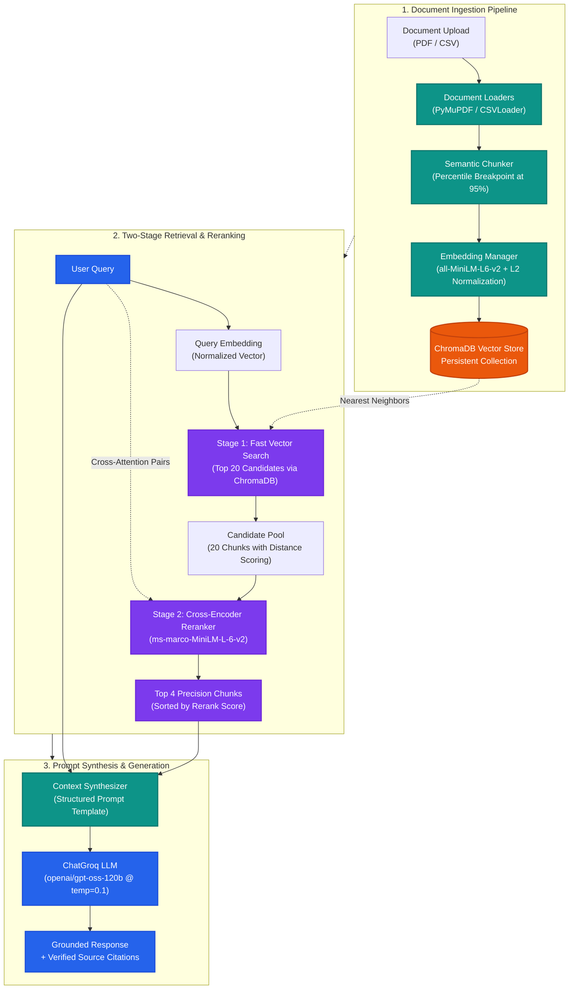

<div align="center">

# ⚡ NexusRAG: High-Precision 2-Stage RAG Platform

<p align="center">
  <strong>Production-ready Retrieval-Augmented Generation featuring Semantic Chunking, ChromaDB Vector Store, 2-Stage Cross-Encoder Reranking, and Groq LPU LLM Acceleration.</strong>
</p>

[](https://python.org)
[](https://fastapi.tiangolo.com)
[](https://www.trychroma.com/)
[](https://huggingface.co)
[](https://groq.com)
[](https://langchain.com)

</div>

---

## 📌 Overview

**NexusRAG** is an advanced, high-precision Retrieval-Augmented Generation (RAG) system designed to solve common retrieval failure modes (such as lost-in-the-middle phenomena, semantic mismatch, and threshold filtering drops). 

By decoupling retrieval into a **high-recall vector candidate search** followed by a **high-precision cross-attention reranker**, NexusRAG guarantees that only the most contextually relevant passages reach the LLM context window—drastically cutting hallucinations and token waste.

---

## 🏗️ Visual Architecture

The system operates across two primary pipelines: the **Document Ingestion Pipeline** and the **2-Stage Retrieval & Inference Pipeline**.

### System Architecture Flowchart



---

## 🧠 Why 2-Stage Retrieval with Reranking?

Standard RAG architectures rely exclusively on **Bi-Encoders** (e.g., embedding similarity). While fast, bi-encoders encode questions and documents separately into static vectors, missing nuanced token-to-token interactions.

NexusRAG employs an industry-standard **Two-Stage Pattern**:

| Stage | Component | Model / Engine | Purpose | Speed | Precision |
| :--- | :--- | :--- | :--- | :--- | :--- |
| **Stage 1** | Candidate Retrieval | `all-MiniLM-L6-v2` in ChromaDB | High Recall: Cast a wide net to pull the **Top 20** candidate chunks. | ⚡ ~5ms | Medium |
| **Stage 2** | Cross-Encoder Reranker | `cross-encoder/ms-marco-MiniLM-L-6-v2` | High Precision: Evaluates `(query, passage)` pairs together via cross-attention to pick the **Top 4** chunks. | ⏱️ ~15ms | 🎯 Near Human-Level |

```
Query + Candidate Chunks
          │
          ▼
┌────────────────────────────────────────────────────────┐
│  Stage 1: Bi-Encoder (Fast Rough Search)               │
│  Candidate #14 has similarity 0.44 due to synonyms     │
└────────────────────────────────────────────────────────┘
          │
          ▼
┌────────────────────────────────────────────────────────┐
│  Stage 2: Cross-Encoder (Deep Attention Analysis)      │
│  Evaluates question & text simultaneously              │
│  Promotes Candidate #14 ──► RANK #1 (Score: +0.520)   │
└────────────────────────────────────────────────────────┘
          │
          ▼
    LLM Context (Only High-Signal Data)
```

---

## ✨ Key Features

- **Semantic Chunking:** Utilizes LangChain's `SemanticChunker` with statistical percentile thresholds (95th percentile breakpoint) to divide text where meaning naturally changes, preserving coherent thoughts.
- **Normalized Vector Search:** Enforces vector normalization on unit spheres, pairing with distance-aware similarity transforms across Euclidean ($L_2$) and Cosine spaces.
- **Local Neural Reranking:** Embedded `CrossEncoder` inference running directly on CPU/GPU without external reranking API subscription fees.
- **Groq LPU Acceleration:** Ultra-low latency responses powered by Groq's high-speed inference engine using `openai/gpt-oss-120b`.
- **Interactive Source Citations:** AI chat responses render a collapsible accordion displaying attributed source files, rank badges (`#1`, `#2`), neural rerank scores, and document metadata.
- **Mobile-Responsive Interface:** Native off-canvas drawer navigation, backdrop overlay, adaptive touch sizing, and responsive layout optimized across desktop, tablet, and mobile devices.
- **Fixed UI Lifecycle:** Smooth button loading state handling, eliminating persistent spinner glitches on the Send button.

---

## 📂 Repository Structure

```text
RAG-PROJECT-1/
├── app/
│   ├── dependencies/
│   │   ├── bm25_Retreiver.py       # BM25 sparse lexical retrieval engine
│   │   ├── embedding_manager.py    # SentenceTransformers embedding model (all-MiniLM-L6-v2)
│   │   ├── fies_load.py            # PyMuPDF & CSVLoader document processors
│   │   ├── rag_retriever.py        # 2-stage retriever orchestrating vector search & reranking
│   │   ├── reranker_services.py    # CrossEncoder reranker service (ms-marco-MiniLM-L-6-v2)
│   │   ├── RRF_.py                 # Reciprocal Rank Fusion algorithm for hybrid retrieval
│   │   ├── text_splitter.py        # Semantic Chunker with percentile thresholds
│   │   └── vector_store.py         # Persistent ChromaDB client & collection management
│   ├── routers/
│   │   ├── chat_routers.py         # POST /chat/ endpoint with context prompt engineering
│   │   └── file_upload_routes.py   # Upload, show, and delete file management endpoints
│   ├── services/
│   │   ├── chat_response_services.py # Grounded prompt assembly & Groq LLM response generation
│   │   └── upload_file_services.py   # Ingestion pipeline linking parsing, splitting, & ChromaDB
│   └── main.py                     # FastAPI application factory & lifespan state lifecycle
├── frontend/
│   ├── index.html                  # Mobile-responsive RAG dashboard with off-canvas drawer
│   ├── style.css                   # Glassmorphic UI, responsive drawer, and citation styling
│   └── app.js                      # API connectors, drawer controller, & source citation renderer
├── uploads/                        # Document staging directory
├── vectorstore/                    # ChromaDB persistent database and index files
├── pyproject.toml                  # Project metadata, dependencies, and build specs
└── requirements.txt                # Pinned pip requirements
```

---

## 🚀 Quick Start Guide

### 1. Prerequisites
- **Python 3.14+** (or Python 3.10+)
- **Git**
- A **Groq API Key** (obtain free from [console.groq.com](https://console.groq.com))

### 2. Clone & Environment Setup

```bash
# Clone the repository
git clone <your-repo-url>
cd "RAG project -1"

# Create a virtual environment
python -m venv .venv

# Activate virtual environment
# Windows (PowerShell):
.\.venv\Scripts\Activate.ps1
# Linux / macOS:
source .venv/bin/activate

# Install dependencies using uv (recommended) or pip
pip install -r requirements.txt
```

### 3. Configure API Credentials

Set your Groq API key in your environment or update `app/main.py`:

```bash
# Windows PowerShell
$env:GROQ_API_KEY="your-groq-api-key-here"

# Linux / macOS
export GROQ_API_KEY="your-groq-api-key-here"
```

### 4. Run the Application

```bash
uvicorn app.main:app --reload --host 127.0.0.1 --port 8000
```

Once started:
- 🌐 **Web Dashboard:** [http://127.0.0.1:8000/app/](http://127.0.0.1:8000/app/)
- 📖 **Interactive Swagger Docs:** [http://127.0.0.1:8000/docs](http://127.0.0.1:8000/docs)

---

## 📡 API Reference

### 1. Chat with RAG
**`POST /chat/`**

Queries the knowledge base, triggers 2-stage retrieval, and generates an answer with citations.

* **Parameters:** `prompt` (query string or body)
* **Response:**
```json
{
  "data": {
    "You": "In an imbalanced fraud-detection dataset, why might accuracy be misleading?",
    "Ai": "Accuracy is misleading because a naive model predicting the majority class (non-fraud) can achieve high accuracy while failing to detect any fraud cases...",
    "sources": [
      {
        "id": "doc_868acdec_4",
        "rank": 1,
        "score": 0.5203,
        "metadata": {
          "source": "fraud_detection_guide.pdf",
          "file_type": "pdf",
          "doc_index": 4
        }
      }
    ]
  }
}
```

---

### 2. Document Management

| Method | Endpoint | Description |
| :--- | :--- | :--- |
| `POST` | `/file/upload` | Upload a PDF or CSV file for automatic parsing, semantic chunking, and embedding. |
| `GET` | `/file/show` | Returns a list of all active files ingested into the knowledge base. |
| `DELETE` | `/file/delete?filename=...` | Deletes a file from disk and wipes its vectors from ChromaDB. |

---

## 🛠️ Verification & Testing

Verify that your embedding and reranking models load and operate properly:

```bash
python -c "
from app.dependencies.embedding_manager import EmbeddingManager
from app.dependencies.reranker_services import RerankerManager
from app.dependencies.vector_store import Vector_Store
from app.dependencies.rag_retriever import RAGRetriver

em = EmbeddingManager()
vs = Vector_Store()
reranker = RerankerManager()
retriever = RAGRetriver(embedding_manager=em, vectorstore=vs, reranker=reranker)

results = retriever.retrive('sample query', initial_top_k=5, final_top_k=2)
print(f'Retrieved {len(results)} verified documents!')
"
```

---

## 📄 License & Attribution

Developed with ❤️ for high-precision enterprise AI applications.  
Maintained by **Safvan Sidheeq** ([mkdsafwan4@gmail.com](mailto:mkdsafwan4@gmail.com)).
